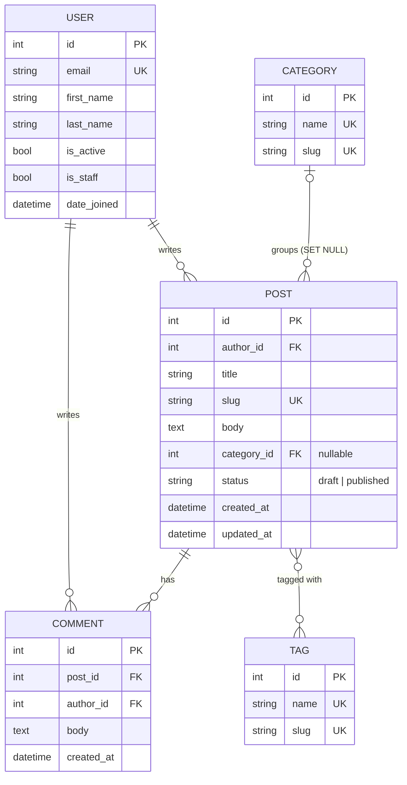

# Blog API

A blog built with Django 5.2: custom email-based user, posts, comments, categories and tags,
a fake-data seed command and an admin panel on [Django Unfold](https://unfoldadmin.com/).

## Quick start

```bash
python -m venv .venv && source .venv/bin/activate
pip install -r requirements/dev.txt

python manage.py migrate
python manage.py seed
python manage.py createsuperuser
python manage.py runserver
```

Open http://127.0.0.1:8000/admin/.

Settings are read from `settings/.env` (copy `settings/.env.example`). All variables start with `BLOG_`.
`BLOG_ENV_ID=local` uses `settings.env.local` (SQLite), `BLOG_ENV_ID=prod` uses `settings.env.prod` (PostgreSQL,
install `requirements/prod.txt`).

## Project structure

```
manage.py
requirements/   base.txt, dev.txt, prod.txt
settings/       conf.py (.env reader), base.py, urls.py, wsgi.py, asgi.py, env/local.py, env/prod.py
apps/auths/     custom User (login by email)
apps/blog/      Category, Tag, Post, Comment, admin, seed command, Unfold callbacks
templates/      admin/index.html (dashboard)
docs/           ERD and screenshots
logs/           log files (not committed)
```

## ERD



> Homework 1 asks for an exported image: render the diagram above (for example on https://mermaid.live)
> and save it as `docs/erd.png`.

## Seeding

```bash
python manage.py seed [--users N] [--posts N] [--comments N] [--clear]
```

| Argument     | Default | Description                                                    |
|--------------|---------|----------------------------------------------------------------|
| `--users`    | `20`    | Number of users to create                                      |
| `--posts`    | `100`   | Number of posts to create                                      |
| `--comments` | `500`   | Number of comments to create                                   |
| `--clear`    | off     | Delete existing data first (superusers are always kept)        |

What it creates:

- **Users** with names from Faker, unique emails and one password for everyone: `seedpass123`
  (constant `SEED_PASSWORD`, hashed once). About 15% are inactive and about 10% are staff.
- **8 categories and 20 tags** with real names. Existing ones are skipped.
- **Posts** with unique slugs (`my-post`, `my-post-2`), about 70% published and 30% drafts,
  about 10% without a category, 0–5 tags each.
- **Comments** only on published posts.

Everything is written with `bulk_create`. Running `seed` twice does not crash. A clear error
(`CommandError`) is shown for negative numbers, for posts/comments without users and for
comments without published posts.

Example:

```
$ python manage.py seed --users 50 --posts 300 --comments 1500
Users:       50 created
Categories:   8 created
Tags:        20 created
Posts:      300 created
Comments:  1500 created
Done in 2.41 seconds
```

## Admin

Built with Django Unfold: custom emerald palette, environment badge (Local / Production),
site dropdown, `Ctrl+K` / `Cmd+K` search over all models and a custom sidebar
(Users & Access is visible only to superusers).

- **Dashboard** – cards, posts per category, top 5 authors, published vs drafts.
- **Posts** – status labels, tag dropdowns, comment counts, All / Published / Drafts tabs, filters
  applied with a button, expandable rows with comments, bulk / row / list / detail / submit-line actions,
  tabbed edit form with a WYSIWYG body, unsaved-changes warning and inline comments.
- **Users** – header column, colored labels, radio filters, tabbed forms, Activate / Deactivate actions.
- **Categories, Tags, Comments** – search, counts, autocomplete and filters without N+1 queries.

### Screenshots

Take these four screenshots and save them in `docs/screenshots/`:

| File                              | What to show                       |
|-----------------------------------|------------------------------------|
| `dashboard.png`                   | the admin home page                |
| `post-list-filters.png`           | post list with the filters open    |
| `post-edit.png`                   | post edit page                     |
| `user-list.png`                   | user list                          |


## Code style

```bash
ruff check .
ruff format .
```
